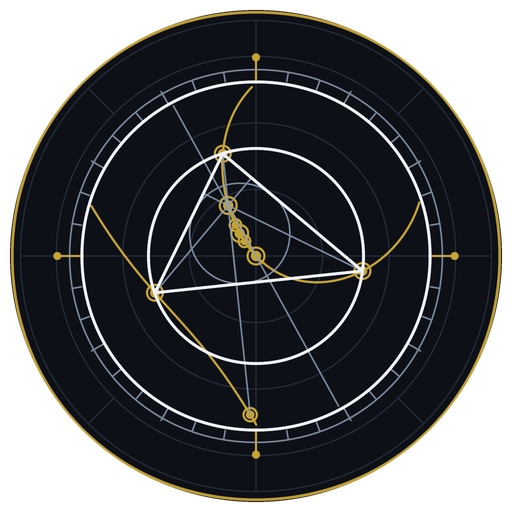

<a href="https://geometor.github.io/gibert/"></a>

# GEOMETOR • gibert

**Visit the Online Archive:** https://geometor.github.io/gibert/

<p align="center">
  <a href="https://geometor.github.io/gibert/"></a>
</p>

**Exact SymPy toolkit and GEOMETOR catalog for Bernard Gibert's Catalogue of Triangle Cubics (CTC)**

## Mission

`geometor/gibert` is part of the interconnected [GEOMETOR](https://geometor.com) semantic digital archive. Grounded in *Catalogue of Triangle Cubics* (Bernard Gibert), it models mathematical structures as atomic, one-item-per-page symbolic constructions in exact `SymPy` algebra linked across 2,400 years of geometric treatises.

## Catalogs in This Archive

- [Catalogue of Triangle Cubics](https://geometor.github.io/gibert/catalog/) — Exact symbolic catalog & concordance inspired by **Bernard Gibert** (`docsrc/catalog/`).

## Repository Contents

- `docsrc/` — One-item-per-page mathematical catalog RST pages and theme-adaptive SVG diagrams compiled by [PHOTON publish](https://github.com/photon-platform/publish).
- `resources/` — `catalog_manifest.json`, `concordance.json`, and structured registries (`persons.json`, `citations.json`, `glossary.json`).
- `src/geometor/gibert/` — Exact `SymPy` symbolic catalog generators and algebraic invariant verifiers.

## Local Build & Verification

```bash
publish build
uv run --no-sync pytest
ruff check src tests demos
```
## Part of the GEOMETOR Knowledge Archive

Explore all **74 Book Codices** and **11 Mathematical Catalogs** at https://geometor.com/books/.
