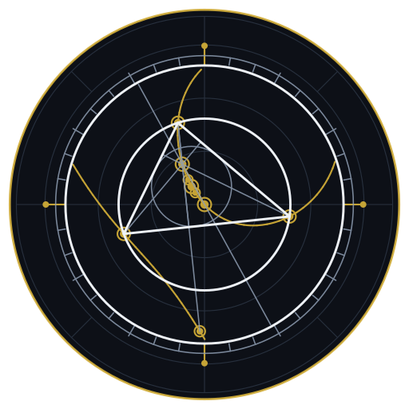

:site_title: Catalogue of Triangle Cubics

.. container:: author-overline

   semantic digital archive • mathematical catalog

============================
Catalogue of Triangle Cubics
============================

Inspired by **Bernard Gibert**'s *Catalogue of Triangle Cubics* (CTC), this digital edition models classical pivotal, non-pivotal, and central triangle cubics as atomic, one-item-per-page symbolic constructions in exact ``SymPy`` algebra. Every curve—from the Neuberg cubic (``K001``) and Thomson cubic (``K002``) onward—is paired with calibrated vector diagrams and cross-referenced directly to Kimberling's *Encyclopedia of Triangle Centers* (`ETC`).

Catalog & Symbolic Toolkit
--------------------------

.. container:: home-book-hero

   .. container:: home-book-thumb

      .. image:: _static/svg/K001.svg
         :alt: K001 Neuberg Cubic on Reference Triangle ABC
         :target: catalog/index.html

   .. container:: home-book-body

      .. rubric:: Mathematical Catalog · K001–K011 · Book Codex

      **Catalogue of Triangle Cubics** — Inspect each cataloged cubic on its own standalone page with formal enunciation, conjugacy class, pole and pivot centers, calibrated vector locus over a scalene reference triangle :math:`ABC`, and verified SymPy equations.

      .. container:: home-actions

         * :doc:`Browse the Catalog → <catalog/index>`
         * :doc:`K001 — Neuberg Cubic → <catalog/K001/index>`
         * :doc:`K002 — Thomson Cubic → <catalog/K002/index>`

.. container:: home-book-hero

   .. container:: home-book-thumb

      .. image:: _static/svg/K002.svg
         :alt: K002 Thomson Cubic Diagram
         :target: demos/index.html

   .. container:: home-book-body

      .. rubric:: Python Toolkit · CLI & Symbolic Verification

      **Exact SymPy Cubic Engine** — Build and verify triangle cubics programmatically via ``geometor.gibert``, explore runnable demonstration notebooks, and inspect the structured catalog manifests and concordance registries.

      .. container:: home-actions

         * :doc:`Interactive Demos → <demos/index>`
         * :doc:`Usage & CLI Guide → <usage/index>`
         * :doc:`Python API Reference → <modules/index>`

Key Features
------------

.. container:: home-feature-grid

   .. container:: home-feature-card

      **Exact Barycentric & Isogonal Algebra**

      Every cubic's pole, pivot, and characteristic equation is verified symbolically in ``SymPy`` with zero floating-point drift.

   .. container:: home-feature-card

      **Calibrated SVG Locus Plates**

      Each curve renders on a scalene reference triangle alongside circumcircle guides and verified Kimberling triangle centers.

   .. container:: home-feature-card

      **ETC Center Concordance**

      Poles, pivots, and distinguished points on every cubic link directly to their corresponding entries in the GEOMETOR *Encyclopedia of Triangle Centers* edition.

Reference & Project
-------------------

.. container:: home-columns

   .. container:: home-col

      .. rubric:: Scholarly Apparatus

      * :doc:`Bibliography <bibliography>` — Bernard Gibert's CTC archive, primary treatises, and triangle geometry references
      * :doc:`Glossary <glossary>` — Definitions of pivotal cubics, isogonal and isotomic conjugates, and barycentric invariants
      * :doc:`Catalog Index <catalog/index>` — Complete listing of cataloged ``K``-series cubics

   .. container:: home-col

      .. rubric:: About This Project

      * :doc:`About This Edition <about/index>` — Scope, symbolic architecture, and repository layout
      * :doc:`Using This Edition <usage/index>` — CLI commands, test verification, and local build workflow
      * :doc:`Research Log <log/index>`, :doc:`Changelog <changelog>` & :doc:`Connect <connect>` — Development notes and community links
